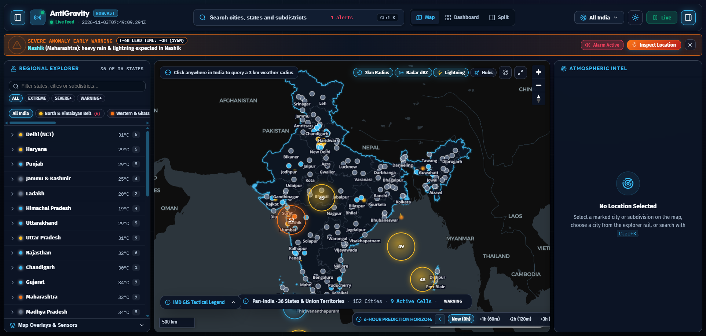
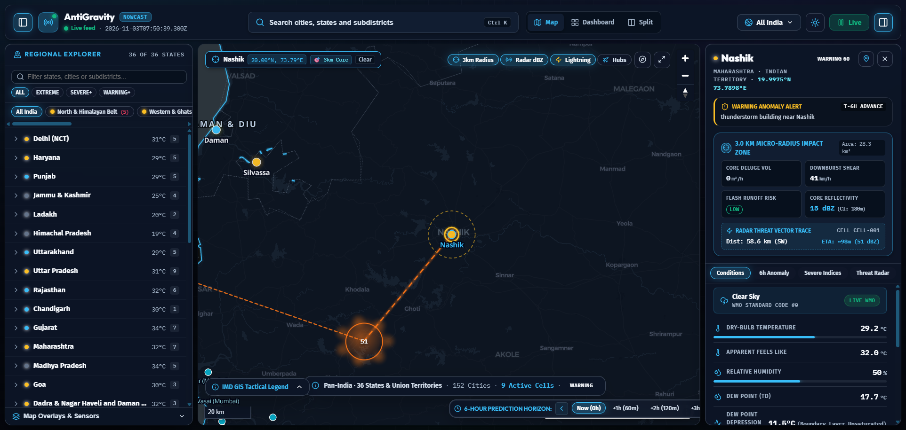
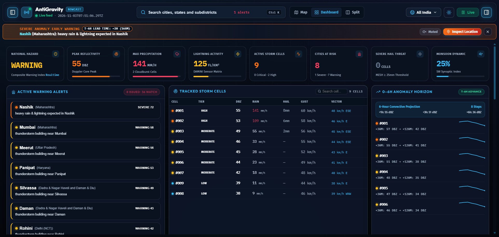
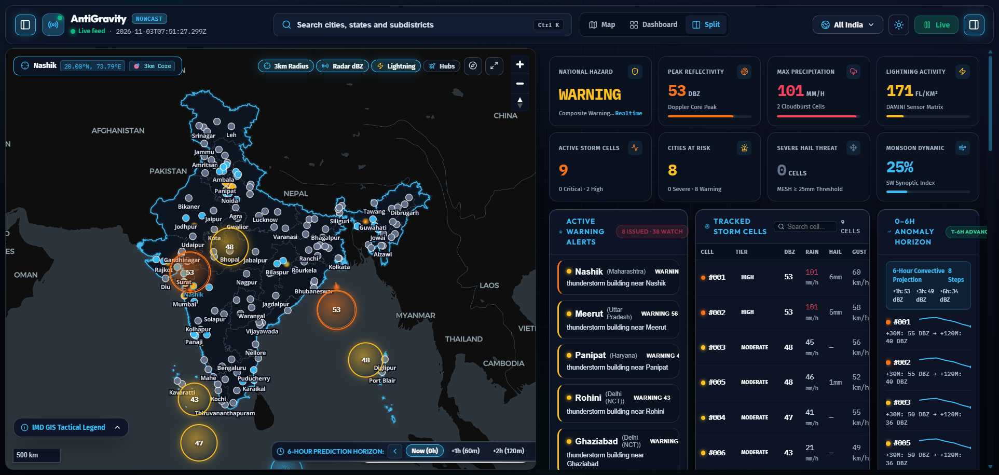
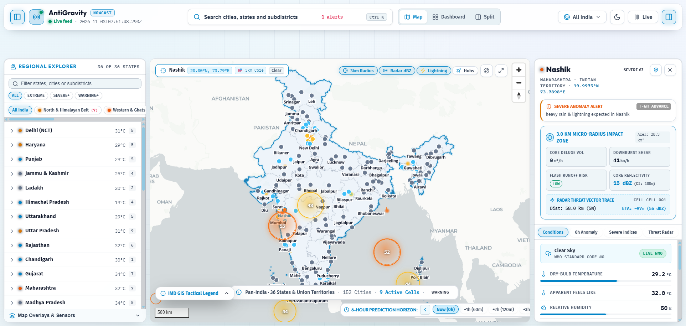

# ⛈️ Weather Sentinel

### Real-Time Pan-India Severe Convective Weather Nowcasting & 3D Atmospheric Intelligence Platform

[](LICENSE)
[](https://python.org)
[](https://fastapi.tiangolo.com)
[](https://react.dev)
[](https://www.typescriptlang.org/)
[](https://maplibre.org)
[](https://postgis.net)
[](https://redis.io)
[](https://docker.com)
[](api/alerts/cap)

---

## 📖 Overview

**Weather Sentinel** is a next-generation, high-resolution meteorological nowcasting and atmospheric intelligence platform built specifically for the Indian subcontinent. It fuses Doppler Weather Radar (DWR) reflectivity, INSAT-3D/3DR geostationary satellite multispectral imagery, and lightning flash density into a unified real-time telemetry grid. 

Powered by physics-informed spatio-temporal deep learning (ConvLSTM), Weather Sentinel predicts severe convective storms, downbursts, localized deluges, and lightning events with lead times of up to **6 hours** at a granular **3.0 km micro-radius** scale.

---

## 📸 System Screenshots & Visual Walkthrough

> *For a full detailed visual tour with feature breakdowns, see [`docs/SCREENSHOTS.md`](docs/SCREENSHOTS.md).*

### 1. Tactical GIS Radar Map & Nowcasting Timeline
*Full Pan-India territorial extent with live radar dBZ heatmaps and scrollable 0–6 hour prediction scrubber.*


---

### 2. City Intelligence Panel & 3.0 km Micro-Radius Impact Zone
*Localized micro-radius convective impact metrics (core deluge volume, downburst shear velocity, flash runoff risk, radar threat vector trace, and scrollable analytical tabs).*


---

### 3. Analytical Mission Control Dashboard
*Comprehensive multi-zone hazard matrices, convective risk indices, infrastructure target watches, and 12-step nowcast progression.*


---

### 4. Dual-Console Split Hybrid Mode
*Synchronized dual-monitor operations terminal combining GIS tactical spatial intelligence with analytical telemetry.*


---

### 5. High-Visibility Carto Positron Daylight Theme
*High-contrast light mode designed for emergency operations centers (EOC) and outdoor field operations.*


---

## ⚡ Core Capabilities

- **🎯 3.0 km Micro-Radius Impact Telemetry:** Automatically computes core deluge volume ($m^3/h$), downburst shear velocity ($km/h$), and flash runoff probability for any pinned coordinate or selected city.
- **🛰️ Multimodal Sensor Fusion:** Synchronizes Doppler Weather Radar (dBZ), satellite thermal IR, lightning flash density, and numerical weather model variables into a 5-channel tensor grid.
- **🧠 ConvLSTM Deep Learning Nowcaster:** Spatio-temporal recurrent neural network predicting convective cell evolution and trajectory across 12 discrete time-steps (0–120 min) with lead times extending up to 6 hours.
- **⚡ Radar Threat Vector Tracing:** Calculates real-time distance, bearing, and estimated time of arrival (ETA in minutes) of threatening storm cells heading toward monitored metropolitan areas and critical infrastructure.
- **🚨 NDMA / OASIS CAP-CP v1.2 Protocol:** Native automated Common Alerting Protocol XML generator complying with Indian National Disaster Management Authority (NDMA) standards.
- **🗺️ Survey of India (SOI) Compliant GIS:** High-fidelity vector boundaries strictly compliant with official Survey of India national territorial maps.

---

## 🗂️ Clean 3-Tier Architecture

```
weather-sentinel/
│
├── 🎨 frontend/               # TIER 1: User Interface & GIS Mission Control
│   ├── src/                  # React 18, MapLibre GL, components, hooks
│   ├── public/geo/           # Official Survey of India GeoJSON boundaries
│   ├── vercel.json           # 1-Click Vercel SPA deployment config
│   ├── netlify.toml          # 1-Click Netlify SPA deployment config
│   ├── Dockerfile            # Multi-stage production Nginx container
│   ├── package.json          # Node dependencies & Vite build scripts
│   └── README.md             # Frontend deployment quickstart
│
├── ⚡ backend/                # TIER 2: FastAPI Engine, Physics & ML Nowcasting
│   ├── main.py               # Broadcast loop & WebSocket streaming server
│   ├── routes/api.py         # REST endpoints & NDMA CAP-XML alert service
│   ├── models/               # ConvLSTM neural network & pretrained weights
│   ├── pipelines/            # Radar, satellite, and lightning fusion pipelines
│   ├── tests/                # System validation & unit tests
│   ├── Dockerfile            # Production Python container with OpenCV
│   ├── requirements.txt      # Python dependencies (FastAPI, PyTorch, etc.)
│   └── README.md             # Backend deployment quickstart
│
└── 🗄️ database/               # TIER 3: Spatial Storage & Schemas
    ├── init_db.sql           # PostGIS extensions, storm tables & landmarks
    ├── docker-compose.yml    # Standalone PostGIS & Redis container runner
    └── README.md             # Database deployment quickstart
```

---

## 🚀 Quickstart & Local Setup

### Option A: 1-Click Launchers
* **Windows**: Double-click [`start.bat`](start.bat)
* **Linux / macOS**: Run `./start.sh`

### Option B: Manual Setup

#### 1. Backend (FastAPI + PyTorch)
```bash
cd backend
python -m venv .venv

# Activate:
.venv\Scripts\activate       # Windows
source .venv/bin/activate    # Linux / macOS

pip install -r requirements.txt
python main.py
```
*Backend runs on `http://localhost:8000` with interactive Swagger docs at `http://localhost:8000/docs`.*

#### 2. Frontend (React 18 + Vite)
```bash
cd frontend
npm install
npm run dev
```
*Frontend runs on `http://localhost:5173`.*

#### 3. Database & Cache (Optional Local Docker)
```bash
cd database
docker compose up -d
```

---

## 🌐 Cloud Deployment Guide

### Deploying the Full Stack in 3 Steps:

```
 ┌──────────────────────┐      ┌──────────────────────┐      ┌──────────────────────┐
 │   1. DATABASE        │      │   2. BACKEND         │      │   3. FRONTEND        │
 │   Supabase / RDS     │ ───► │   Render / Railway   │ ───► │   Vercel / Netlify   │
 │   Paste init_db.sql  │      │   Point to backend/  │      │   Point to frontend/ │
 └──────────────────────┘      └──────────────────────┘      └──────────────────────┘
```

#### Step 1: Database (PostgreSQL + PostGIS)
1. Create a free project on **[Supabase](https://supabase.com)**.
2. In Supabase Dashboard, go to **Database** -> **Extensions**, enable **`postgis`**.
3. Open the **SQL Editor**, paste the contents of [`database/init_db.sql`](database/init_db.sql), and click **Run**.
4. Copy your database connection URI.

#### Step 2: Backend (Render or Railway)
1. Link your repository on **[Render](https://render.com)** or **[Railway](https://railway.app)**.
2. Set Root Directory to `backend`.
3. Set environment variables:
   - `DATABASE_URL` = *(Your PostgreSQL connection string)*
   - `DEMO_MODE` = `True`
4. Deploy service and copy your backend URL (e.g. `https://weather-sentinel-api.onrender.com`).

#### Step 3: Frontend (Vercel or Netlify)
1. Import repository on **[Vercel](https://vercel.com)**.
2. Set Root Directory to `frontend`.
3. Set environment variables:
   - `VITE_API_BASE_URL` = `https://<backend-domain>/api`
   - `VITE_WS_BASE_URL` = `wss://<backend-domain>`
4. Click **Deploy**.

---

## 🐳 Full-Stack Docker Deployment (VPS / Self-Hosted)

Run the entire production stack (PostGIS + Redis + FastAPI + Frontend) in one command:

```bash
# 1. Clone repository
git clone https://github.com/abhimanyu1502/weather-sentinel.git
cd weather-sentinel

# 2. Launch production containers
docker compose -f docker-compose.prod.yml up -d --build
```

Access points:
* **Frontend Web App**: `http://localhost:80`
* **FastAPI Backend**: `http://localhost:8000/api`
* **Live WebSocket**: `ws://localhost:8000/ws/live-stream`
* **Interactive API Docs**: `http://localhost:8000/docs`

---

## 🧪 Testing & Validation

Run the automated physics, tensor fusion, and nowcasting validation suite:

```bash
cd backend
python tests/validation/run_all_checks.py
```

Expected output:
```
============================================================
🚀 Weather Sentinel — System Validation Checklist
============================================================
1. Testing Physics Engine (CI & Indices)...
  ✅ Convective Initiation detection: OK
2. Testing 5-Channel Grid Tensor Fusion...
  ✅ (5, 128, 128) Multimodal Tensor Fusion: OK
3. Testing Storm Cell Kinematics & ETA Countdowns...
  ✅ Haversine & Kinematics (14.1 km): OK
4. Testing ML ConvLSTM Nowcasting Engine...
  ✅ ConvLSTM 0-120 min horizon predictions (12 steps): OK
============================================================
🎉 ALL VALIDATION CHECKS PASSED SUCCESSFULLY!
============================================================
```

---

## 📡 REST API & WebSocket Protocol

| Method | Endpoint | Description |
|---|---|---|
| `GET` | `/api/health` | Health probe & system version |
| `GET` | `/api/regions` | 6 Pan-India radar sectors + National overview |
| `GET` | `/api/landmarks?region={id}` | High-value infrastructure targets (Airports, Railway hubs) |
| `GET` | `/api/current-hazards` | Active convective storm cells & hazard telemetry |
| `GET` | `/api/dashboard/summary` | Pan-India summary (Max dBZ, rain rate, strokes) |
| `POST`| `/api/failover` | Radar outage failover to satellite-only mode |
| `POST`| `/api/ai-advisory` | AI multilingual meteorological advisory |
| `GET` | `/api/alerts/cap` | **OASIS / NDMA Common Alerting Protocol (CAP-CP v1.2) XML** |
| `WS`  | `/ws/live-stream` | Real-time global telemetry stream (3s broadcast interval) |
| `WS`  | `/ws/regions/{id}` | Sector-specific telemetry stream |

---

## 📜 License & Accreditation

* **License**: [MIT License](LICENSE)
* **Author**: Abhimanyu Tiwari ([@abhimanyu1502](https://github.com/abhimanyu1502))
* **GIS Accreditation**: Official Survey of India national territorial boundary guidelines strictly implemented.
