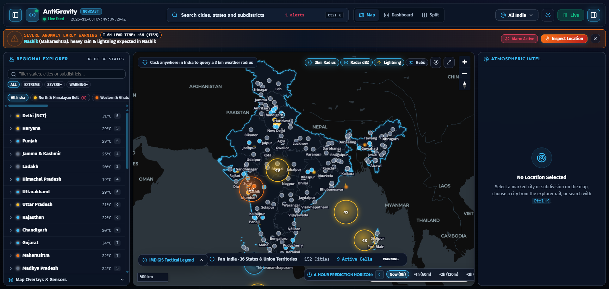
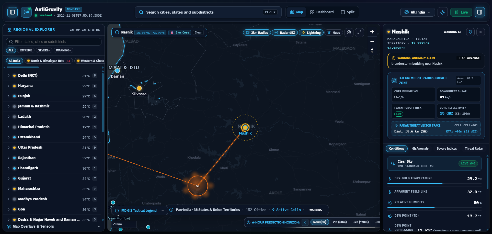
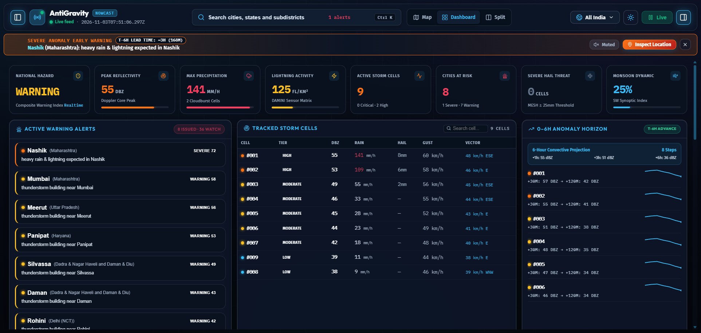
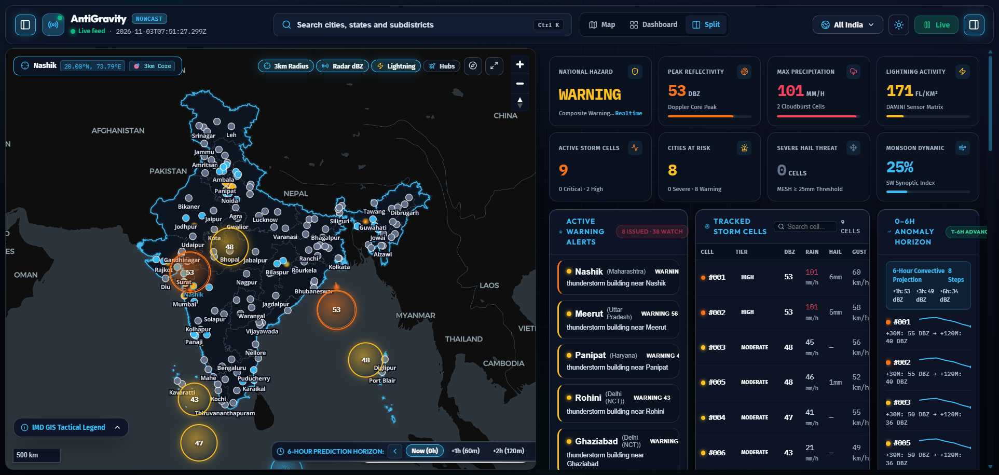
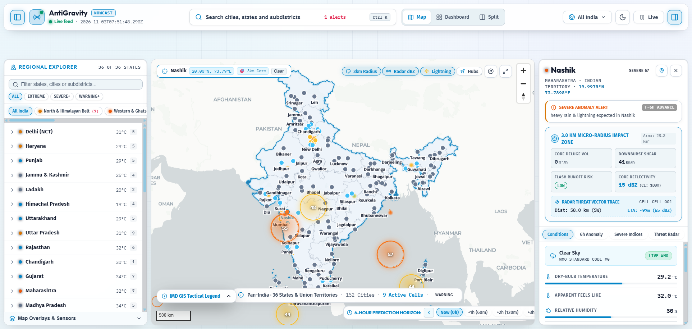

# 📸 Weather Sentinel — Visual Walkthrough & System Screenshots

This document provides a visual guide to the major operational surfaces and mission control modules of **Weather Sentinel**.

---

## 1. Tactical GIS Radar Map & Nowcast Timeline

* **Official Survey of India Boundaries:** Compliant national territorial extent including Kashmir, Ladakh, Andaman & Nicobar, and Lakshadweep.
* **Multimodal Radar Heatmap:** Real-time composite Doppler radar reflectivity (dBZ) gradient overlays.
* **Scrollable 6-Hour Prediction Scrubber:** ConvLSTM nowcasting horizon timeline with interactive step navigation (`Now (0h)` through `+6h (360m)`).
* **Telemetry HUD & Tactical Legend:** Live status indicating active monitored cities, active storm cells, and composite national hazard status.

---

## 2. City Intelligence Panel & Micro-Radius Impact Zone

* **3.0 km Micro-Radius Threat Zone:** Instantaneous calculation of estimated core deluge volume ($m^3/h$), downburst shear velocity ($km/h$), flash runoff risk rating, and core reflectivity.
* **Radar Threat Vector Trace:** Real-time distance, bearing, and estimated time of arrival (ETA in minutes) of approaching storm cells.
* **Scrollable Intelligence Tabs:** Multi-tab analytical viewer covering **Threat Radar**, **Conditions**, **6h Anomaly**, and **Severe Indices**.
* **GPS Target Reticle:** High-precision coordinate pinning with 1-click clipboard export.

---

## 3. Analytical Mission Control Dashboard

* **Severe Convective Risk Matrices:** Regional hazard breakdown across North, West, Central, East, South, and Northeast zones.
* **12-Step Nowcast Progression:** Real-time time-series telemetry monitoring convective evolution and cell decay.
* **Infrastructure Target Monitoring:** Strategic airport hubs, railway nodes, and critical high-value installations under active convective watch.

---

## 4. Dual-Console Split Hybrid Mode

* **Side-by-Side Operations:** GIS Tactical Map on the left console and Analytical Mission Control on the right console.
* **Synchronized State:** Clicking a cell or region on either pane instantly centers and filters the opposing pane.
* **Ideal for Emergency Operations Centers (EOC):** Designed for dual-screen mission control stations and multi-operator disaster response teams.

---

## 5. High-Visibility Carto Positron Light Theme

* **High-Contrast Daytime Visibility:** Optimized for daylight operations, outdoor field tablets, and briefing presentations.
* **Full Feature Parity:** Identical vector GIS layering, sensor overlays, and real-time WebSocket telemetry stream.
